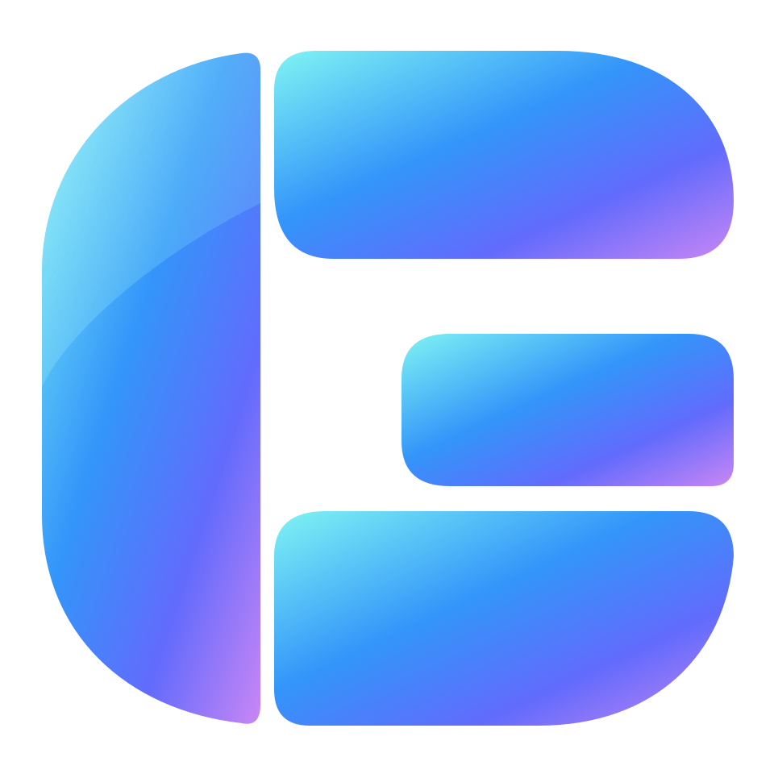

# Glass UX



A typed React 19 component library for glass interfaces, data applications and assistant
experiences. Components use Base UI behaviour, semantic CSS tokens, container queries and
shared keyboard and accessibility conventions.

## Install

Install the versioned package attached to a [GitHub release](https://github.com/Dastari/glass-ux/releases).

```sh
pnpm add https://github.com/Dastari/glass-ux/releases/download/v0.11.1/glass-ux-0.11.1.tgz
```

React 19 and React DOM 19 are peer dependencies. The tested integration uses Vite 8
and Tailwind 4; the App Router fixture also builds with Next.js 16 and webpack. Supported browsers are current Chrome, Edge, Firefox and Safari, and
Firefox ESR 140 (the Firefox in Debian 12 and 13). Register `glassUx()` from `glass-ux/vite` beside the React and Tailwind plugins. Import components through their public entries:

```tsx
import { Button } from "glass-ux/button";
import { Dialog } from "glass-ux/dialog";
import { DataTable } from "glass-ux/data-table";
import { AssistantPane } from "glass-ux/ai";
import "glass-ux/styles.css";

export function SaveButton() {
  return (
    <Button variant="primary" onClick={() => console.info("Saved")}>
      Save changes
    </Button>
  );
}
```

The application owns the Tailwind pipeline, authentication, routing, data adapters and
branding. With Tailwind 4, include the package in source discovery:

```css
@import "tailwindcss";
@import "glass-ux/styles.css";
@source "../node_modules/glass-ux/dist";
```

Supply `TooltipProvider`, `ActionProvider`, `PaletteProvider` and `AppearanceProvider` at
the application root when using their respective components. See the component API for
their props and controlled/uncontrolled state contracts.

Optional server adapters are separate entries. The graphql-orm filter mapping moved from
`glass-ux/lib/graphql-orm/where` and `…/evaluate` to `glass-ux/adapters/graphql-orm`; see
[Data tables, filters and server adapters](docs/data-filters.md).

## Documentation and demos

- [Installation, providers and your first form](docs/getting-started.md).
- [Migrating an existing application](docs/integration.md).
- [Theme geometry and layout verification](docs/layout-contract.md).
- [Component and browser testing helpers](docs/testing.md).
- [AI agent skills and adoption](docs/agent-adoption.md).
- [Changelog](CHANGELOG.md) and [migration guide](docs/migration.md) for upgrades.

- [Component API index](docs/api/README.md), generated from the exported TypeScript types.
- [Typed input guides](docs/components/README.md).
- [Design and accessibility rules](docs/ui-rules.md).
- [Live documentation site](https://dastari.github.io/glass-ux/): a studio workspace (charts,
  a grouped project table with drag-to-reorder priorities, sheets and a typed form dialog),
  a scripted assistant chat beside a phone preview, a live network-operations workspace
  (map, site table, device topology windows, review notes and account switching with
  `LoginFlow`) and appearance controls for the six canvas backgrounds, UI scale, corner
  radius and line weight. Component family pages combine related examples with section navigation and
  API references for every public export.

Each release also attaches the built documentation site as `glass-ux-docs.tar.gz`, for
hosting the catalogue offline. The package itself carries no gallery or demo code.

All sample organisations, people, identifiers, conversations and values are fictional.
The demo portraits are generated faces approved by the repository owner for redistribution.
They are demo assets; the component runtime never assumes a person or a data source.

## Agent skills

```sh
pnpm exec glass-ux skills install --target agents
```

Six bundled skills cover adoption, component selection, forms, tables and charts, assistant
UI and library authoring. They read the documentation installed with the same release.
The command preserves existing project instructions and requires `--update` before replacing
already installed Glass UX skills. `--target claude` installs under `.claude/skills`.

## Development

```sh
pnpm install
pnpm build
pnpm dev             # documentation site on http://127.0.0.1:4220
pnpm dev:flat        # Flat comparison preview on http://127.0.0.1:4230 (also serves the LAN)
pnpm check
pnpm docs:build      # package, API reference and static documentation site
pnpm test:e2e
```

TypeScript 6 is pinned for the TypeDoc compiler API. Consumers may use newer TypeScript
versions. Releases contain ESM JavaScript, declaration files and maps, CSS, bundled fonts,
offline Markdown guides and the generated API model. No build runs when a release package
is installed.

## Licence

The code is [MIT licensed](LICENSE). Bundled font licences and demo-asset provenance are
recorded in [third-party assets](docs/assets.md).
